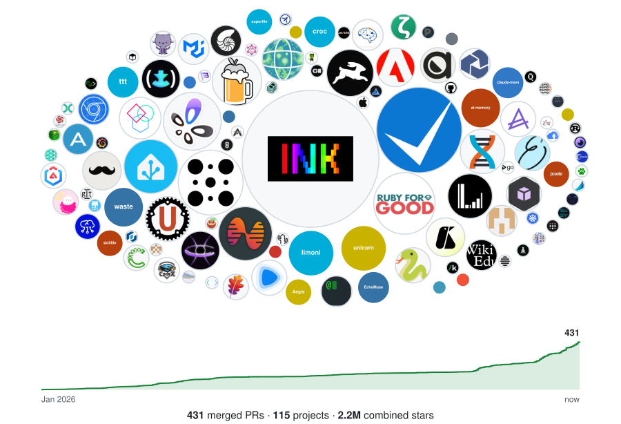

Hi, I'm John. I build developer tools and contribute to the ones I use.

<a href="https://jcosta.tech/contributions.html">
  <picture>
    <source media="(prefers-color-scheme: dark)" srcset="https://raw.githubusercontent.com/costajohnt/costajohnt/main/assets/contributions-dark.svg" />
    
  </picture>
</a>

[jcosta.tech](https://jcosta.tech)

